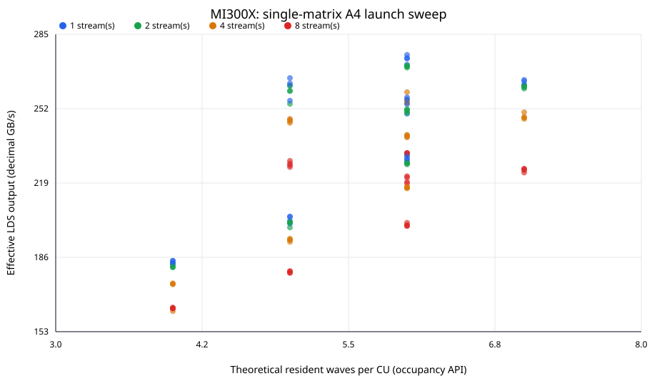

# H3 T4 single-matrix launch sweep — mi300x

Slurm job `110403` completed with 112/112 valid sweep points.

Workload is the one real GLM-5.2-FP8 layer-0 `gate_proj` matrix (12,288 × 6,144, 72 MiB); one matrix, one replica. The MI350X-created ANS artifact is consumed unchanged on the selected GPU; the archive is device-independent and its source/reference hashes are checked. Each invocation verifies actual LDS output byte-for-byte.

The 112-point sweep crosses threads 64–448, grid multiplier 1/2/4/8, and 1/2/4/8 HIP streams (5 warmups, 30 timed HIP-event iterations). The top three configurations receive a fresh 10-warmup/50-iteration confirmation. Throughput is decoded output bytes divided by median time, decimal GB/s.

Occupancy x-values use the HIP occupancy API's maximum resident workgroups per CU × waves per workgroup. They are theoretical resource limits, not measured time-average wave occupancy. Repeated single-matrix reads are cache-resident-sized; this is not the HBM-streaming 1b case.

Best confirmed: **275.28 GB/s** at threads=128, grid=2, streams=1; median=0.274254 ms.

## Top sweep points

| Rank | Threads | Grid × | Streams | Theoretical waves/CU | Median ms | Effective LDS GB/s |
|---:|---:|---:|---:|---:|---:|---:|
| 1 | 128 | 2 | 1 | 6 | 0.274095 | 275.44 |
| 2 | 128 | 8 | 1 | 6 | 0.275516 | 274.02 |
| 3 | 128 | 4 | 1 | 6 | 0.275756 | 273.78 |
| 4 | 128 | 1 | 1 | 6 | 0.278480 | 271.11 |
| 5 | 128 | 1 | 2 | 6 | 0.278901 | 270.70 |
| 6 | 128 | 2 | 2 | 6 | 0.279142 | 270.46 |
| 7 | 128 | 8 | 2 | 6 | 0.279362 | 270.25 |
| 8 | 128 | 4 | 2 | 6 | 0.279823 | 269.80 |
| 9 | 64 | 4 | 1 | 5 | 0.284689 | 265.19 |
| 10 | 448 | 4 | 1 | 7 | 0.285591 | 264.35 |

## Grouped by theoretical resident waves/CU

| Waves/CU | Configurations | Median throughput range GB/s |
|---:|---:|---:|
| 4 | 16 | 177.79 (161.91–184.28) |
| 5 | 32 | 214.79 (178.86–265.19) |
| 6 | 48 | 235.41 (199.54–275.44) |
| 7 | 16 | 255.26 (223.31–264.35) |

Raw point-level measurements and provenance are in the sibling JSON file. The sweep changes launch/deployment parameters only; it does not modify the codec or decoder algorithm.
