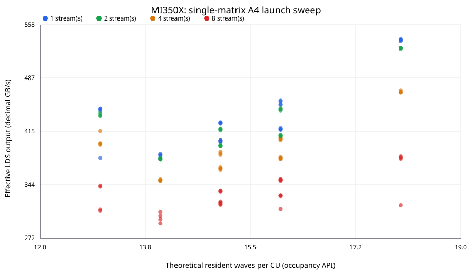

# H3 T4 single-matrix launch sweep — mi350x

Slurm job `110404` completed with 112/112 valid sweep points.

Workload is the one real GLM-5.2-FP8 layer-0 `gate_proj` matrix (12,288 × 6,144, 72 MiB); one matrix, one replica. The MI350X-created ANS artifact is consumed unchanged on the selected GPU; the archive is device-independent and its source/reference hashes are checked. Each invocation verifies actual LDS output byte-for-byte.

The 112-point sweep crosses threads 64–448, grid multiplier 1/2/4/8, and 1/2/4/8 HIP streams (5 warmups, 30 timed HIP-event iterations). The top three configurations receive a fresh 10-warmup/50-iteration confirmation. Throughput is decoded output bytes divided by median time, decimal GB/s.

Occupancy x-values use the HIP occupancy API's maximum resident workgroups per CU × waves per workgroup. They are theoretical resource limits, not measured time-average wave occupancy. Repeated single-matrix reads are cache-resident-sized; this is not the HBM-streaming 1b case.

Best confirmed: **540.04 GB/s** at threads=384, grid=1, streams=1; median=0.139801 ms.

## Top sweep points

| Rank | Threads | Grid × | Streams | Theoretical waves/CU | Median ms | Effective LDS GB/s |
|---:|---:|---:|---:|---:|---:|---:|
| 1 | 384 | 1 | 1 | 18 | 0.140241 | 538.34 |
| 2 | 384 | 8 | 1 | 18 | 0.140361 | 537.88 |
| 3 | 384 | 4 | 1 | 18 | 0.140561 | 537.12 |
| 4 | 384 | 2 | 1 | 18 | 0.140841 | 536.05 |
| 5 | 384 | 4 | 2 | 18 | 0.143221 | 527.14 |
| 6 | 384 | 1 | 2 | 18 | 0.143241 | 527.07 |
| 7 | 384 | 2 | 2 | 18 | 0.143341 | 526.70 |
| 8 | 384 | 8 | 2 | 18 | 0.143761 | 525.16 |
| 9 | 384 | 2 | 4 | 18 | 0.160662 | 469.92 |
| 10 | 384 | 4 | 4 | 18 | 0.161380 | 467.82 |

## Grouped by theoretical resident waves/CU

| Waves/CU | Configurations | Median throughput range GB/s |
|---:|---:|---:|
| 13 | 16 | 407.35 (308.63–445.62) |
| 14 | 16 | 364.14 (291.94–384.72) |
| 15 | 32 | 395.50 (316.92–427.31) |
| 16 | 32 | 407.67 (311.07–456.18) |
| 18 | 16 | 497.54 (316.20–538.34) |

Raw point-level measurements and provenance are in the sibling JSON file. The sweep changes launch/deployment parameters only; it does not modify the codec or decoder algorithm.
